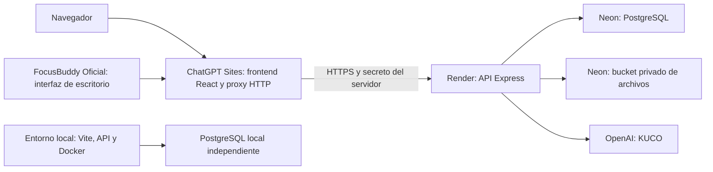

# Alojamiento de demostración: Sites, Render y Neon

Estado verificado el 11 de noviembre de 2026: backend oficial actualizado en
Render al commit `14399452de89fd2aef1f0c059d3384f92fcf46f3`, con las 14
migraciones aplicadas en Neon. El frontend publicado en Sites es la versión 3.
El dominio canónico es
`https://konea-campus-connect.danaealvarez0917.chatgpt.site`; el dominio anterior
redirige a este. Ambos orígenes conocidos están autorizados en Render.

Se comprobó salud HTTP 200 y autenticación, y se conservó un respaldo sin
compute en Neon: `before-focusbuddy-official-20261111`. La migración se probó
primero en una rama temporal y conservó usuarios, sesiones y relaciones. No se
restauró la base local sobre la oficial. FocusBuddy 0.1.2 se publicó mediante
GitHub Actions desde `8ec46a87d52095c62f06419e381c53478a512b27`, con un enlace
de descarga en la portada pública y en el portal autenticado.

El instalador publicado se descargó completo (155489433 bytes) y su SHA-256
coincide con el checksum del release:
`077cbb26dc1b27034fd3864493bbd274c722efce753751cd02f97a80d2d596a8`.

Antes de una demostración remota debe registrarse el commit o versión alojada,
la configuración de API y los flujos comprobados. El hecho de que abra la
portada no acredita por sí mismo login, archivos, IA o sincronización. El
procedimiento siguiente describe cómo preparar o actualizar el entorno; no
supone que deban recrearse recursos que ya existen.

## Arquitectura



Se conservan React, TypeScript, Vite, Express, PostgreSQL y Drizzle. El adaptador
de publicación usa el starter Vinext de Sites; no reemplaza las pantallas de
Konea. Sites recibe el frontend compilado, nunca el respaldo de la base de datos.
La conexión PostgreSQL y la IA se ejecutan en Render. En producción, las imágenes
y adjuntos usan almacenamiento de objetos privado, ya que el disco gratuito de
Render es temporal.

Checkout independiente de Sites: `D:\konea-rebirth\Konea-Sites-Demo`.
Su `.openai/hosting.json` conserva la identidad del proyecto y declara `d1: null`
y `r2: null`: este despliegue mantiene PostgreSQL en Neon.

## Conexiones y credenciales

Conectar los plugins de Neon y Render permite administrar los recursos desde
ChatGPT sin enviar contraseñas por el chat. OpenAI Developers permite configurar
el acceso de KUCO por el flujo de credenciales de OpenAI.

Los valores se configuran como secretos del proveedor. El archivo
`hosting/hosting.env.example` contiene únicamente los nombres que necesitan las
herramientas de copia. Si se usa configuración manual, copiarlo a
`.env.hosting.local`, que está ignorado por Git. El `.env` de desarrollo se mantiene.

| Destino                   | Configuración                                                                                                                                                                      |
| ------------------------- | ---------------------------------------------------------------------------------------------------------------------------------------------------------------------------------- |
| Sites                     | `KONEA_BACKEND_ORIGIN`: origen HTTPS exacto del servicio Render; `SITES_BACKEND_TOKEN`: secreto compartido con Render.                                                             |
| Render                    | `DATABASE_URL`: conexión Neon con TLS; `CORS_ORIGIN`: origen de Sites; `SITES_BACKEND_TOKEN`: mismo secreto; `UPLOAD_STORAGE=s3`; variables `S3_*`; credenciales y modelo de KUCO. |
| Herramientas de migración | `HOSTED_DATABASE_URL`: destino remoto nuevo; las mismas variables `S3_*` del bucket privado.                                                                                       |

No incluir claves de OpenAI, acceso S3, credenciales de PostgreSQL o el secreto
del proxy en variables `VITE_*`, instaladores, repositorios, capturas ni documentos.

## Primera puesta en marcha y copia

1. Crear una base PostgreSQL **nueva y vacía** y un bucket privado en Neon.
   Seleccionar una región compatible con Object Storage y cercana a la API.
2. Crear un respaldo de la base local y los archivos:

   ```powershell
   node scripts/hosting/export-local-database.mjs
   node scripts/hosting/verify-local-backup.mjs --backup '<carpeta del respaldo>'
   ```

3. Restaurar la copia antes del primer arranque de Render:

   ```powershell
   node scripts/hosting/restore-hosted-database.mjs --backup '<carpeta del respaldo>'
   ```

   El script comprueba SHA-256, exige TLS y un destino remoto vacío, y aplica una
   transacción con validación de conteos. No usa `--clean` ni escribe en la base
   local. La copia completa conserva las sesiones en el archivo de respaldo;
   el destino remoto las excluye para exigir un nuevo inicio de sesión.

4. Copiar los archivos del mismo respaldo al bucket mediante
   `scripts/hosting/import-hosted-uploads.mjs`. Conservar nombres y rutas de la
   API. Verificar el resultado antes de habilitar acceso a la demo.
5. Crear el servicio gratuito con `render.yaml` y `Dockerfile.api`, completar
   secretos y arrancar. Las migraciones se aplican antes de escuchar HTTP;
   **no** se ejecutan seeders ni se crean cuentas `admin/admin` en el arranque.
   No arrancar contra una base vacía antes del paso de restauración: las
   migraciones crearían objetos y la restauración rechazaría el destino.
6. Configurar el origen de Render y el secreto del proxy en Sites. Preparar
   cambios del frontend con:

   ```powershell
   node scripts/hosting/prepare-sites.mjs --directory 'D:\konea-rebirth\Konea-Sites-Demo' --focusbuddy-download-url 'https://github.com/SrCazuela/Konea-Rebirth/releases/download/focusbuddy-v0.1.2/Konea-FocusBuddy-Windows-x64.exe'
   ```

   Publicar con el flujo de Sites conservando el mismo `project_id` y la audiencia
   pública verificada. No volver a crear el proyecto para cada actualización.

El respaldo inicial verificado contiene 33 tablas, 583 filas y 64 adjuntos.
Los archivos completos y la evidencia están en `.local/hosting/`; esa carpeta
está ignorada por Git y no se incluye en la imagen Docker ni en Sites.

## Acceso y verificación

La audiencia pública de Sites permite abrir la web y acceder al proxy; los datos
privados siguen exigiendo una sesión Konea con sus roles y permisos. El proxy
transmite solamente `konea_session`, sin reenviar cookies, autorizaciones ni
identidad de ChatGPT. La API exige el secreto del proxy, salvo el healthcheck básico.

Antes de dar la demo por terminada verificar, con una cuenta estudiantil y otra
administrativa: login/logout, sesión persistente, foro e imágenes, chat y
adjuntos, materias/tareas, solicitudes, métricas de estudio, permisos entre
usuarios y KUCO. Probar archivos después de reiniciar Render. Comprobar que una
petición directa a Render sin el secreto no permite leer datos ni consumir IA.

El repositorio incluye pruebas de restauración, integridad de archivos,
transacción de copia, protección del destino, proxy y cookies. En 0.1.2 se
comprobó el ejecutable oficial contra la API publicada: login, persistencia,
logout, consulta de cuenta y sincronización de sesiones y tareas. Una cuenta
temporal exclusiva permitió probar las escrituras sin modificar datos de los
estudiantes; se eliminó después junto con todos sus registros asociados.

## Desarrollo y límites

Las bases son independientes: crear una tarea en la demo no modifica la base
local y viceversa. Una actualización de código no vuelve a importar el respaldo.
No intentar sincronizar bases mediante restauraciones repetidas sobre datos
existentes. Las nuevas migraciones se aplican por separado en cada entorno.

El plan gratuito de Render puede detener su instancia por inactividad y tardar
en reactivarla. La verificación observó respuestas HTML 503/429 durante ese
arranque, seguidas de salud 200 JSON. Usar los límites y cuotas vigentes de cada
proveedor; no contratar planes de pago automáticamente. El consumo de KUCO
sigue usando los créditos de API configurados.

FocusBuddy sincroniza sesiones, tareas y cuenta cuando usa la misma API que
la web. La sincronización local no copia datos a Neon ni cambia el destino de
un instalador existente. Se distribuyen dos canales con identidad, perfil de
sesión y protocolo separados:

- **Local**: solo API loopback; `iniciar-focusbuddy.bat` abre el entorno de
  desarrollo. La web local usa `konea-focusbuddy-local://open`. Sus datos
  pertenecen al PostgreSQL local.
- **Oficial**: API remota HTTPS fijada durante el build; la web alojada usa
  `konea-focusbuddy://open`. El estudiante inicia sesión en el programa con su
  cuenta del entorno publicado. La ausencia de una API válida detiene el build
  y nunca selecciona localhost como alternativa.

Para el canal oficial puede usarse la URL pública de Sites seguida de
`/api/v1`, configurada con `FOCUSBUDDY_API_URL` durante el build; el proxy
agrega el secreto únicamente en el servidor y conserva la cookie de Konea.
El cliente no recibe el secreto del proxy ni las credenciales PostgreSQL.

Cada nueva distribución debe verificar acceso, login, persistencia de cookie,
tareas y transiciones de sesión desde ambos clientes, como se hizo con 0.1.2.
El sitio actual es público; las rutas privadas conservan la autenticación Konea.
**Nunca** incorporar `SITES_BACKEND_TOKEN` al cliente ni desactivar la protección
para simular conectividad.

Los botones de apertura solo solicitan abrir el programa del canal
correspondiente. No distribuyen una actualización, no cambian su endpoint y no
inician sesión por el estudiante. Los ejecutables de cada canal se generan en
`apps/focusbuddy/release/local/` y `apps/focusbuddy/release/production/`.

La descarga de la web alojada requiere publicar y comprobar el artefacto oficial
`Konea-FocusBuddy-Windows-x64.exe` en GitHub Releases del repositorio
`SrCazuela/Konea-Rebirth`. Después se configura
`VITE_FOCUSBUDDY_DOWNLOAD_URL` con ese enlace HTTPS al compilar; al preparar
Sites se pasa mediante `--focusbuddy-download-url` para conservarlo en el
frontend. No admite URL local, otro repositorio, credenciales, query string o
fragmento. Sin enlace válido aparece **Versión oficial aún no publicada**. La
web local ofrece abrir su propio cliente, sin descargar el instalador oficial.
Véanse comandos y validación en [focusbuddy.md](./focusbuddy.md).

El instalador local 0.1.1 generado antes de separar canales incorpora
`http://localhost:3000/api/v1`; no debe presentarse como cliente de la demo
alojada. La disponibilidad de la web no transforma una instalación local en
un cliente remoto. Registrar el artefacto oficial, su API y el resultado de las
pruebas remotas antes de anunciarlo como disponible.

La Fase 1 ya evaluada se conserva. Los documentos de Fase 2 sirven como línea
base histórica; la revisión técnica de Fase 3 debe distinguir implementación
local, versión publicada y recorridos remotos efectivamente comprobados. El
modelo de datos PostgreSQL se conserva y las nuevas migraciones se aplican por
entorno, sin restaurar repetidamente la base local sobre una demo en uso.

## Referencias oficiales

- [Sites: conexiones y almacenamiento](https://learn.chatgpt.com/docs/sites/data-and-connections).
- [Render: servicios gratuitos y disco temporal](https://render.com/docs/free).
- [Neon: planes y límites](https://neon.com/pricing).
- [Neon: Object Storage](https://neon.com/docs/storage/overview).
