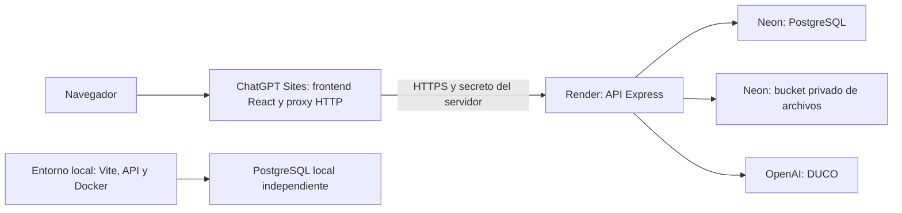

# Alojamiento de demostración: Sites, Render y Neon

Estado al 1 de noviembre de 2026: frontend y adaptador preparados y compilados;
proyecto de Sites creado privado; respaldo local completo verificado. La
restauración remota y la puesta en marcha integral están pendientes de conectar
las cuentas de Neon y Render. Esto no constituye todavía una demo operativa.

## Arquitectura



Se conservan React, TypeScript, Vite, Express, PostgreSQL y Drizzle. El adaptador
de publicación usa el starter Vinext de Sites; no reemplaza las pantallas de
Konea. Sites recibe el frontend compilado, nunca el respaldo de la base de datos.
La conexión PostgreSQL y la IA se ejecutan en Render. En producción, las imágenes
y adjuntos usan almacenamiento de objetos privado, ya que el disco gratuito de
Render es temporal.

Checkout independiente de Sites: `D:\konea-rebirth\Konea-Sites-Demo`.
Su `.openai/hosting.json` conserva la identidad del proyecto y declara `d1: null`
y `r2: null`: este despliegue mantiene PostgreSQL en Neon.

## Conexiones y credenciales

Conectar los plugins de Neon y Render permite administrar los recursos desde
ChatGPT sin enviar contraseñas por el chat. OpenAI Developers permite configurar
el acceso de DUCO por el flujo de credenciales de OpenAI.

Los valores se configuran como secretos del proveedor. El archivo
`hosting/hosting.env.example` contiene únicamente los nombres que necesitan las
herramientas de copia. Si se usa configuración manual, copiarlo a
`.env.hosting.local`, que está ignorado por Git. El `.env` de desarrollo se mantiene.

| Destino                   | Configuración                                                                                                                                                                      |
| ------------------------- | ---------------------------------------------------------------------------------------------------------------------------------------------------------------------------------- |
| Sites                     | `KONEA_BACKEND_ORIGIN`: origen HTTPS exacto del servicio Render; `SITES_BACKEND_TOKEN`: secreto compartido con Render.                                                             |
| Render                    | `DATABASE_URL`: conexión Neon con TLS; `CORS_ORIGIN`: origen de Sites; `SITES_BACKEND_TOKEN`: mismo secreto; `UPLOAD_STORAGE=s3`; variables `S3_*`; credenciales y modelo de DUCO. |
| Herramientas de migración | `HOSTED_DATABASE_URL`: destino remoto nuevo; las mismas variables `S3_*` del bucket privado.                                                                                       |

No incluir claves de OpenAI, acceso S3, credenciales de PostgreSQL o el secreto
del proxy en variables `VITE_*`, instaladores, repositorios, capturas ni documentos.

## Orden de despliegue y copia

1. Crear una base PostgreSQL **nueva y vacía** y un bucket privado en Neon.
   Seleccionar una región compatible con Object Storage y cercana a la API.
2. Crear un respaldo de la base local y los archivos:

   ```powershell
   node scripts/hosting/export-local-database.mjs
   node scripts/hosting/verify-local-backup.mjs --backup '<carpeta del respaldo>'
   ```

3. Restaurar la copia antes del primer arranque de Render:

   ```powershell
   node scripts/hosting/restore-hosted-database.mjs --backup '<carpeta del respaldo>'
   ```

   El script comprueba SHA-256, exige TLS y un destino remoto vacío, y aplica una
   transacción con validación de conteos. No usa `--clean` ni escribe en la base
   local. La copia completa conserva las sesiones en el archivo de respaldo;
   el destino remoto las excluye para exigir un nuevo inicio de sesión.

4. Copiar los archivos del mismo respaldo al bucket mediante
   `scripts/hosting/import-hosted-uploads.mjs`. Conservar nombres y rutas de la
   API. Verificar el resultado antes de habilitar acceso a la demo.
5. Crear el servicio gratuito con `render.yaml` y `Dockerfile.api`, completar
   secretos y arrancar. Las migraciones se aplican antes de escuchar HTTP;
   **no** se ejecutan seeders ni se crean cuentas `admin/admin` en el arranque.
   No arrancar contra una base vacía antes del paso de restauración: las
   migraciones crearían objetos y la restauración rechazaría el destino.
6. Configurar el origen de Render y el secreto del proxy en Sites. Preparar
   cambios del frontend con:

   ```powershell
   node scripts/hosting/prepare-sites.mjs --directory 'D:\konea-rebirth\Konea-Sites-Demo'
   ```

   Publicar con el flujo de Sites conservando el mismo `project_id` y el acceso
   privado. No volver a crear el proyecto para cada actualización.

El respaldo inicial verificado contiene 33 tablas, 583 filas y 64 adjuntos.
Los archivos completos y la evidencia están en `.local/hosting/`; esa carpeta
está ignorada por Git y no se incluye en la imagen Docker ni en Sites.

## Acceso y verificación

Sites conserva su control de acceso y las cuentas de Konea conservan sus roles
y permisos. El proxy transmite solamente `konea_session`; nunca reenvía cookies,
autorizaciones ni identidad de ChatGPT al backend. La API exige el secreto del
proxy cuando está configurado, excepto en el healthcheck básico.

Antes de dar la demo por terminada verificar, con una cuenta estudiantil y otra
administrativa: login/logout, sesión persistente, foro e imágenes, chat y
adjuntos, materias/tareas, solicitudes, métricas de estudio, permisos entre
usuarios y DUCO. Probar archivos después de reiniciar Render. Comprobar que una
petición directa a Render sin el secreto no permite leer datos ni consumir IA.

Las pruebas locales de este cambio cubren restauración completa, integridad de
archivos, transacción de copia, protección del destino, proxy y cookies. Las
pruebas en los proveedores quedan pendientes hasta tener las conexiones.

## Desarrollo y límites

Las bases son independientes: crear una tarea en la demo no modifica la base
local y viceversa. Una actualización de código no vuelve a importar el respaldo.
No intentar sincronizar bases mediante restauraciones repetidas sobre datos
existentes. Las nuevas migraciones se aplican por separado en cada entorno.

El plan gratuito de Render puede suspender la API por inactividad; al volver a
abrirla puede tardar en responder. Usar los límites y cuotas vigentes de cada
proveedor; no contratar planes de pago automáticamente. El consumo de DUCO
sigue usando los créditos de API configurados.

FocusBuddy de escritorio conserva su configuración local. Esta primera
integración privada de Sites no permite que el instalador existente acceda al
backend protegido: hará falta resolver el acceso de escritorio y generar y
probar otro instalador. **Nunca** incorporar el secreto del proxy al cliente.

La Fase 1 ya evaluada no se modifica. En la Fase 2, el informe 2.4, el 2.6 y el
manual de despliegue deben distinguir esta preparación de un despliegue remoto
efectivamente validado. El modelo de datos PostgreSQL se conserva.

## Referencias oficiales

- [Sites: conexiones y almacenamiento](https://learn.chatgpt.com/docs/sites/data-and-connections).
- [Render: servicios gratuitos y disco temporal](https://render.com/docs/free).
- [Neon: planes y límites](https://neon.com/pricing).
- [Neon: Object Storage](https://neon.com/docs/storage/overview).
